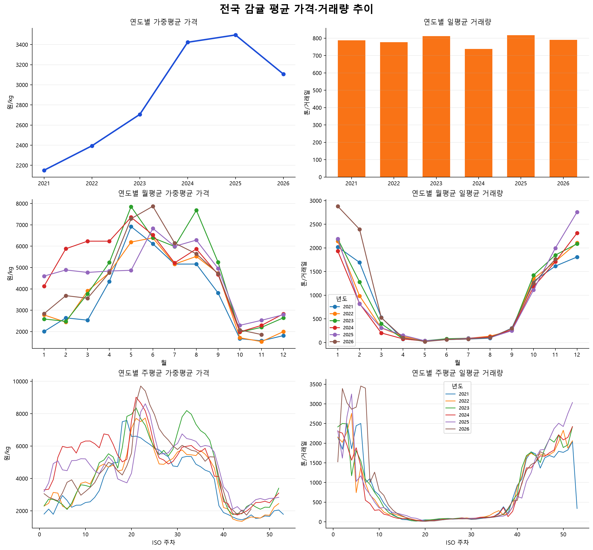
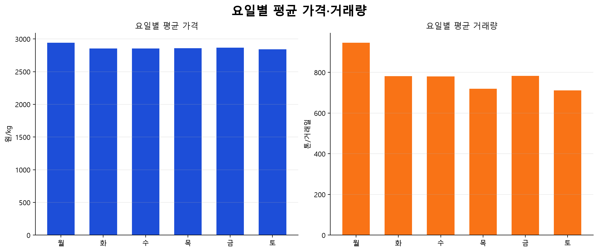
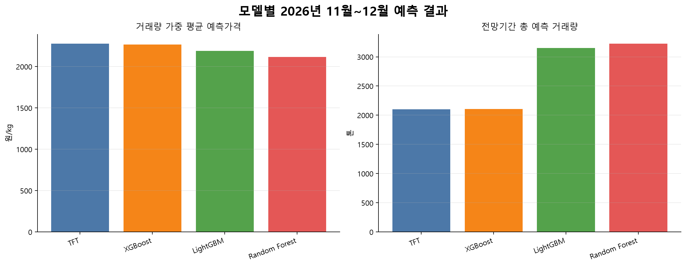

# 🍊 ugasungsi — 전국 공영도매시장 감귤류 가격·거래량 예측 AI 및 대시보드

본 프로젝트는 전국 공영도매시장 감귤류 경매 정산 데이터(공공데이터포털 `katSale` API 및 2018~2026년 일별 거래 데이터)와 제주 4대 기상관측소(제주·서귀포·성산·고산) 실측 기상 데이터(`data/forecast.csv`)를 결합하여, **감귤 품종별·시장별·규격(등급/크기/거래단위)별 일별 경락가격 및 거래물량을 예측하고 시각화하는 통합 머신러닝/딥러닝 시스템**입니다.

---

## 📌 목차

1. [프로젝트 주요 기능 및 특징](#1-프로젝트-주요-기능-및-특징)
2. [프로젝트 디렉토리 구조](#2-프로젝트-디렉토리-구조)
3. [데이터 수집 및 전처리 원칙](#3-데이터-수집-및-전처리-원칙)
4. [감귤 데이터 탐색적 분석(EDA) 결과 (`jhd/preprocess.ipynb`)](#4-감귤-데이터-탐색적-분석eda-결과-jhdpreprocessipynb)
   - [4.1 전체 데이터셋 규모 및 정제 요약](#41-전체-데이터셋-규모-및-정제-요약)
   - [4.2 품종별 거래량·거래금액·평균단가 요약 (상위 12대 품종)](#42-품종별-거래량거래금액평균단가-요약-상위-12대-품종)
   - [4.3 연도별(2021~2026) 및 월별 출하 계절성 추이](#43-연도별20212026-및-월별-출하-계절성-추이)
   - [4.4 품종별 주요 거래단위(Box Unit) 분석](#44-품종별-주요-거래단위box-unit-분석)
   - [4.5 등급(`특/상/중/하/기타`) 및 크기(`Size`) 분포](#45-등급특상중하기타-및-크기size-분포)
   - [4.6 전국 32개 공영도매시장별 거래량 및 가격 비교 (상위 10대 시장)](#46-전국-32개-공영도매시장별-거래량-및-가격-비교-상위-10대-시장)
   - [4.7 연도별·월별·주별 평균 가격 및 거래량 추이](#47-연도별월별주별-평균-가격-및-거래량-추이)
5. [요일별(월~토) 시장 변동 패턴 인사이트](#5-요일별월토-시장-변동-패턴-인사이트)
6. [환경 설정 및 설치 가이드](#6-환경-설정-및-설치-가이드)
7. [실행 방법 (Streamlit 대시보드 / 모델 학습 / 노트북)](#7-실행-방법-streamlit-대시보드--모델-학습--노트북)
8. [모델 아키텍처 및 예측 튜닝](#8-모델-아키텍처-및-예측-튜닝)
   - [8.1 모델별 가격·거래량 예측 결과](#81-모델별-가격거래량-예측-결과)

---

## 1. 프로젝트 주요 기능 및 특징

- **공공데이터포털 도매시장 경매 데이터 자동 수집**:
  - `getdata.py`, `getcode.py`를 통해 전국 공영도매시장 정산정보(`katSale`) 및 품목/시장 코드를 수집합니다.
- **휴장일(일요일·무거래 공휴일) 및 비수기(Off-Season) 완전 분리**:
  - 경매가 열리지 않는 **일요일 정기 휴장일 및 무거래 공휴일을 학습·예측·평가에서 완전히 제외**하여 순수 영업일(월~토) 기반 시계열을 구축합니다.
  - 품종별 출하기/비수기를 자동 판별하여 미출하기(예: 11월 중순 기준 한라봉·비가림감귤·천혜향·레드향·진지향)를 예측 대상에서 제외합니다.
- **4대 예측 모델**:
  - **TFT (Temporal Fusion Transformer)**, **XGBoost**, **LightGBM**, **Random Forest (Quantile Regression Forest)**를 제공합니다.
- **전년도 동기간 실적 및 수급 모멘텀 하이브리드 튜닝**:
  - 다단계 재귀(Recursive) 예측 시 발생하는 거래량 하향 감쇄(Downward Drift)를 해결하기 위해 **전년도(2025년) 동기간 요일 매칭 실적 + 금년도 수급 모멘텀(YoY Ratio)**을 결합한 하이브리드 튜닝을 적용했습니다.
- **인터랙티브 Streamlit 예측 대시보드**:
  - **`jhd/app.py`**: 전체시장 및 5대 핵심 도매시장(`서울가락시장`, `대구북부시장`, `부산반여시장`, `경기구리시장`, `부산엄궁시장`)별 4대 핵심 품종(`조생귤`, `한라봉`, `하우스감귤`, `천혜향`) 주간(월~토) 가격·거래량 및 P10~P90 불확실성 구간 대시보드.
  - **`app_kig.py`**: Random Forest 번들 기반 감귤 도매시장 수요·시세 예측 대시보드.

---

## 2. 프로젝트 디렉토리 구조

```plaintext
ugasungsi/
├── README.md                                  # 프로젝트 종합 안내 문서
├── requirements.txt                           # Python 패키지 의존성 목록
├── getdata.py                                 # 공공데이터포털 공영도매시장 정산정보 수집 스크립트
├── getcode.py                                 # 도매시장/품목 표준 코드 조회 스크립트
│
├── xgboost.ipynb                              # XGBoost 모델 학습 및 평가 노트북
├── lightgbm.ipynb                             # LightGBM 모델 학습 및 평가 노트북
├── random_forest.ipynb                        # Random Forest 모델 학습 및 평가 노트북
│
├── jhd/                                       # 시장별(전체 + 5대 도매시장) 4개 모델 통합 파이프라인 및 대시보드
│   ├── app.py                                 # 주간(월~토) 4개 모델 가격·거래량 예측 Streamlit 대시보드
│   ├── build_market_predictions.py            # 전체시장 + 5대 도매시장 통합 예측 번들(streamlit_predictions.pkl) 생성 스크립트
│   ├── streamlit_predictions.pkl              # 대시보드용 통합 예측 데이터셋 (2021-01-02 ~ 2026-12-31)
│   ├── inspect_streamlit_predictions.ipynb    # pkl 번들 데이터 구조 점검 노트북
│   ├── preprocess.ipynb                       # 데이터 전처리, 휴장일/비수기 분리, 기상·명절 피처 엔지니어링
│   ├── tft.ipynb                              # TFT 모델 일자별 학습 및 해석성 분석
│   ├── xgboost.ipynb                          # XGBoost 모델 일자별 학습 및 평가
│   ├── lightgbm.ipynb                         # LightGBM 모델 일자별 학습 및 평가
│   └── random_forest.ipynb                    # Random Forest(Quantile) 모델 일자별 학습 및 평가
│
├── kig/                                       # Random Forest 기반 수요·시세 예측 모듈
│   ├── app_kig.py                             # Streamlit 대시보드 (루트 app_kig.py 동일)
│   ├── train_kig.py                           # 모델 학습 스크립트 (루트 train_kig.py 동일)
│   └── citrus_rf_bundle_kig.joblib            # 학습 완료 모델 번들
│
├── data/                                      # 원본 데이터 및 전처리·예측 산출물
│   ├── kat*.csv / mkat*.csv / data1.csv / data2.csv  # 전국 공영도매시장 경매 원본 데이터
│   ├── forecast.csv                           # 기상청 제주 4대 관측소 일별 실측 기상 데이터
│   ├── preprocessed_citrus_data_auction_only.csv     # 경매 전용 전처리 완료 데이터셋
│   ├── citrus_multidim_forecasting_daily.csv  # 영업일 기준 다차원 일별 시계열 데이터셋
│   ├── citrus_forecast_20261111_20261211.csv  # 10대 품종 1개월 일별 4대 모델 예측 결과
│   ├── citrus_7day_forecast_all_items.csv     # 등급 '특' 기준 7일(6영업일) 성수기 세부 규격 예측 (전년 동기 튜닝 반영)
│   ├── citrus_past_vs_next_7days_comparison.csv      # 기존 1주 실적 vs 향후 1주 튜닝 예측 비교표 (일요일 완전 제외)
│   ├── citrus_day_of_week_pattern_analysis.csv       # 요일별(월~토) 거래량·가격 변동 지수 분석표
│   ├── citrus_past_vs_next_7days_chart.png    # 2주간 순수 영업일 실적 vs 튜닝 예측 연속 추세 차트
│   ├── citrus_day_of_week_effect_chart.png    # 요일별(월~토) 물량 및 가격 변동 패턴 시각화 차트
│   ├── citrus_annual_monthly_weekly_average_chart.png # 연도별·월별·주별 평균 가격 및 거래량 추이 차트
│   ├── citrus_day_of_week_average_chart.png     # 요일별 평균 가격 및 거래량 차트
│   └── citrus_model_prediction_summary.png      # 모델별 가격·거래량 예측 결과 차트
│
└── scratch/                                   # 예측 생성, 튜닝, 분석 및 노트북 자동화 유틸리티 스크립트
```

---

## 3. 데이터 수집 및 전처리 원칙

1. **품종 체계**:
   - **10대 주요 품종 (다차원 분석)**: `조생귤`, `한라봉`, `극조생감귤`, `하우스감귤`, `비가림감귤`, `천혜향`, `레드향`, `타이벡감귤`, `황금향`, `진지향`
   - **4대 핵심 품종 (시장별 대시보드 `jhd/app.py`)**: `조생귤`, `한라봉`, `하우스감귤`, `천혜향`
2. **세부 규격 분리**:
   - **등급 (`Grade`)**: `특`, `상`, `중`, `하`, `전체` (7일 세부 예측은 `특` 등급 기준)
   - **크기 (`Size`)**: 품종별 거래건수 상위 5대 규격 + `전체`
   - **포장/거래단위 (`Box`)**: 품종별 거래건수 상위 3~5대 상자 규격(`5kg상자`, `3kg상자`, `10kg상자` 등) + `전체`
3. **외생 변수(피처 엔지니어링)**:
   - **기상 피처**: 1주일 전 제주 산지 평균기온, 기온편차, 누적 강수 지속시간, 일조시간, 최심신적설
   - **명절·캘린더 피처**: 설날·추석 대목(Pre-Surge) 및 명절 직후(Post-Dip) 가우시안 곡선, 연중 주기(`sin/cos`), 요일 효과
   - **시계열 피처**: 영업일 기준 단기/중기 래그($t-1, t-2, t-3, t-7, t-14, t-30$), 이동평균, 전년도 동기간($t-1\text{년}$) 물량·단가 및 변화량

### 3.1 전처리 및 다차원 EDA 분석 흐름

`file_preprocessing.ipynb`에서 다루는 분석 절차는 `data/kat*.csv`와 만감류 파일인 `data/mkat*.csv`를 통합한 뒤, 중복 레코드와 음수·오류 거래 및 극단 이상치를 정리하는 방식입니다. 해당 노트북은 정제 과정과 분석 설계를 설명하며, 첨부된 실행 출력에는 분석 결과 표나 수치가 포함되어 있지 않습니다.

- **품종 코드**: aT 공영도매시장 표준 코드 `07` 한라봉, `08` 천혜향, `09` 레드향, `10` 카라향, `11` 황금향을 사용합니다.
- **파생 지표**: 거래일자와 시계열 변수, 거래물량(`volume_kg`), 상자 수(`box_qty`), 총 거래금액(`total_price`), 상자 단가(`box_price`), kg당 단가(`unit_price_kg`)를 산출합니다.
- **거래유형 비교**: 경매와 수의계약의 거래물량·단가를 비교하고, 수의계약을 제외했을 때 품종·등급별 평균 판매가격 변화와 월별 단가 추이를 분석합니다.
- **다차원 분석**: 날짜별·등급별·품종별·크기별 물량 및 가격을 살펴보고, 품종×크기 시계열과 품종×등급/크기 교차 단가 히트맵도 구성합니다. 상자 크기(3kg·5kg·10kg)와 과수 규격(50내·45내·40내·35내)의 조합별 가격 비교를 포함합니다.
- **내보내기**: 정제 데이터를 모델링 및 후속 분석용 CSV로 저장하는 흐름을 포함합니다.

> 이 분석 노트북의 입력 파일 수(554개)는 작성 시점의 설명입니다. 데이터가 추가되거나 변경될 수 있으므로 현재 저장소의 파일 수와 다를 수 있습니다.

---

## 4. 감귤 데이터 탐색적 분석(EDA) 결과 (`jhd/preprocess.ipynb`)

`jhd/preprocess.ipynb`에서는 전국 공영도매시장 감귤 경매 원본 분할 파일(`data/kat*.csv`, `data/mkat*.csv`) **566개**를 통합·정제하고, 품종·연도·월별 계절성·거래단위·등급·크기·도매시장별 전수 통계 분석을 수행했습니다.

### 4.1 전체 데이터셋 규모 및 정제 요약

- **원본 병합**: 566개 유효 CSV 파일, 총 **1,728,626건** (17개 컬럼)
- **중복 및 이상치 정제**: 중복 1,711건 제거, 0 이하 무효 수량/금액 제거, 극단 단가(`100원/kg 미만` 또는 `100,000원/kg 초과`) 필터링, aT 표준 품종 코드(`07` 한라봉, `08` 천혜향, `09` 레드향, `10` 카라향, `11` 황금향 등) 매핑 및 1,000건 미만 소수 품종·`감귤(일반)`을 `기타`로 통합

| 항목                                            |                                               수치 |
| :---------------------------------------------- | -------------------------------------------------: |
| **전처리 완료 총 거래 건수**              |                             **1,722,631 건** |
| **조회 기간**                             |         **2021-01-02 ~ 2026-11-11** (71개월) |
| **포함 도매시장 수**                      |                   **32개 전국 공영도매시장** |
| **통합 감귤 품종 수**                     |                                **18개 품종** |
| **누적 거래물량**                         |                           **1,171,902.7 톤** |
| **누적 환산상자수**                       |                         **256,992,080 상자** |
| **총 거래금액**                           |                            **35,191.2 억원** |
| **가중평균 kg당 단가 / 평균 상자당 가격** | **3,002.9 원/kg** / **18,765 원/상자** |

### 4.2 품종별 거래량·거래금액·평균단가 요약 (상위 12대 품종)

|     순위     | 품종명                              |              거래건수 (비중) |              누적 거래량 (비중) |             총 거래금액 | 가중평균 단가(원/kg) |    평균 상자당 가격 |
| :----------: | :---------------------------------- | ---------------------------: | ------------------------------: | ----------------------: | -------------------: | ------------------: |
| **1** | **조생귤**                    |           316,478건 (18.37%) | **500,214.2 톤 (42.68%)** | **11,170.8 억원** |             2,233 원 |           10,764 원 |
| **2** | **기타** *(감귤 일반 포함)* |           317,255건 (18.42%) |           236,888.9 톤 (20.21%) |            6,394.7 억원 |             2,699 원 |           18,833 원 |
| **3** | **한라봉**                    | **328,214건 (19.05%)** |            107,411.9 톤 (9.17%) |            5,525.3 억원 |   **5,144 원** | **26,662 원** |
| **4** | **극조생감귤**                |             92,528건 (5.37%) |             97,957.6 톤 (8.36%) |            1,685.4 억원 |             1,721 원 |            8,029 원 |
| **5** | **하우스감귤**                |           322,086건 (18.70%) |             89,987.6 톤 (7.68%) |            4,381.9 억원 |   **4,869 원** |           18,674 원 |
| **6** | **비가림감귤**                |             63,145건 (3.67%) |             36,655.7 톤 (3.13%) |            1,239.2 억원 |             3,381 원 |           15,139 원 |
| **7** | **천혜향**                    |            107,971건 (6.27%) |             34,270.8 톤 (2.92%) |            1,620.7 억원 |   **4,729 원** |           22,357 원 |
| **8** | **레드향**                    |             90,212건 (5.24%) |             27,305.4 톤 (2.33%) |            1,835.3 억원 |   **6,722 원** | **28,031 원** |
| **9** | **타이벡감귤**                |             19,696건 (1.14%) |             16,247.4 톤 (1.39%) |              508.1 억원 |             3,127 원 |           14,447 원 |
| **10** | **온주**                      |              3,307건 (0.19%) |              5,703.4 톤 (0.49%) |              135.9 억원 |             2,383 원 |           12,877 원 |
| **11** | **황금향**                    |             19,035건 (1.10%) |              4,196.7 톤 (0.36%) |              172.7 억원 |             4,116 원 |           15,928 원 |
| **12** | **만생귤**                    |              2,482건 (0.14%) |              3,766.6 톤 (0.32%) |               91.1 억원 |             2,420 원 |           18,595 원 |

*(나머지 6개 품종: 진지향 3,007.6톤, 중생귤 2,957.6톤, 카라향 2,722.4톤, 감귤(수입) 1,061.3톤, 성전 955.2톤, 만감(일반) 592.4톤)*

### 4.3 연도별(2021~2026) 및 월별 출하 계절성 추이

- **연도별 구조 변화**:
  - **조생귤**은 매년 8~9만 톤대를 유지하는 부동의 메인 품종이며, 단가는 2021년 `1,475원/kg` $\rightarrow$ 2025년 `2,876원/kg`으로 지속 상승 후 2026년 `2,480원/kg` 수준을 기록했습니다.
  - **만감류·고당도 품종 급성장**: **천혜향**(`2,256톤(2021)` $\rightarrow$ `14,369톤(2026)`), **레드향**(`2,093톤` $\rightarrow$ `7,684톤`), **타이벡감귤**(`704톤(2023)` $\rightarrow$ `7,409톤(2026)`), **카라향**(`430톤(2025)` $\rightarrow$ `2,217톤(2026)`)의 유통량이 최근 2년간 가파르게 확대되었습니다.
- **주요 품종별 핵심 집중 출하월(Top 3) 및 피크 기록**:
  - **조생귤**: `12월, 1월, 11월` (최대 38,671.2톤 / 2025-12)
  - **한라봉**: `1월, 2월, 3월` (최대 9,067.0톤 / 2022-01)
  - **극조생감귤**: `10월, 11월, 9월` (최대 12,989.5톤 / 2023-10)
  - **하우스감귤**: `9월, 10월, 8월` (최대 4,754.8톤 / 2021-09, 연중 71개월 거래)
  - **비가림감귤**: `2월, 3월, 1월` (최대 4,121.4톤 / 2023-02)
  - **천혜향**: `2월, 3월, 1월` (최대 5,954.2톤 / 2026-02)
  - **레드향**: `1월, 2월, 12월` (최대 4,516.6톤 / 2026-02)
  - **타이벡감귤**: `1월, 12월, 11월` (최대 3,322.5톤 / 2026-01)

### 4.4 품종별 주요 거래단위(Box Unit) 분석

- `3kg/5kg/9kg/10kg`의 `상자`와 `파렛트`를 통합하고, **거래건수 1,000건 이상 & 품종내 비중 1% 이상**인 총 **48개 핵심 `(품종 × 거래단위)` 규격**을 도출했습니다:
  - **조생귤**: `5kg상자`(**86.6%**, 467,094.8톤, 2,224원/kg), `10kg상자`(6.2%), `3kg상자`(3.9%)
  - **한라봉**: `3kg상자`(**40.5%**, 5,786원/kg), `9kg상자`(23.6%, 4,659원/kg), `5kg상자`(19.1%), `10kg상자`(13.6%)
  - **하우스감귤**: `3kg상자`(**49.9%**, 5,980원/kg), `5kg상자`(26.8%, 3,109원/kg), `0.5kg상자`(8.7%), `6kg상자`(3.6%), `10kg상자`(3.4%)
  - **천혜향**: `3kg상자`(**49.2%**, 5,095원/kg), `9kg상자`(20.8%, 4,828원/kg), `5kg상자`(19.7%), `10kg상자`(4.7%)
  - **레드향**: `3kg상자`(**49.5%**, 7,009원/kg), `5kg상자`(31.3%, 7,260원/kg), `9kg상자`(11.2%), `10kg상자`(4.8%)
  - **극조생감귤 / 비가림감귤**: `5kg상자`가 각각 **92.1%**, **80.7%**로 압도적 주력 규격

### 4.5 등급(`특/상/중/하/기타`) 및 크기(`Size`) 분포

- **등급 분포 (전체 1,722,631건)**:
  - **`특`**: **1,307,872건 (75.9%)** | **`기타`**: 214,461건 (12.4%) | **`중`**: 91,030건 (5.3%) | **`상`**: 76,856건 (4.5%) | **`하`**: 32,412건 (1.9%)
- **표준 5대 크기 그룹 분포**:
  - **`미지정`**: 666,199건 (38.7%) | **`중과`**: 443,258건 (25.7%) | **`대과`**: 339,395건 (19.7%) | **`소과`**: 239,662건 (13.9%) | **`기타규격`**: 34,117건 (2.0%)
- **주요 원본 세부 크기 표기**: 온주·하우스감귤 중심의 과수 표기(`50내` 79,848건, `40내` 78,595건, `45내` 47,340건, `35내` 46,592건), 만감류 중심의 개수 표기(`12개` 52,955건, `10개` 51,733건, `11개` 46,063건, `13개` 38,145건), 직접 표기(`특대` 41,306건, `소` 36,781건, `대` 28,040건, `중` 25,246건) 순으로 빈도가 높습니다.

### 4.6 전국 32개 공영도매시장별 거래량 및 가격 비교 (상위 10대 시장)

전국 32개 공영도매시장 중 상위 10개 시장이 전체 감귤 거래량의 **69.0%**를 차지하며, 특히 **서울가락시장(24.13%)**과 **대구북부시장(9.68%)**이 전국 시세를 선도합니다.

|     순위     | 도매시장명                             | 취급품종수 |  거래건수 |              누적 거래량 (비중) |            총 거래금액 | 가중평균 단가(원/kg) | 평균 상자당 가격 |
| :----------: | :------------------------------------- | :--------: | --------: | ------------------------------: | ---------------------: | -------------------: | ---------------: |
| **1** | **서울가락** *(대시보드 포함)* |    17종    | 258,448건 | **282,806.3 톤 (24.13%)** | **9,058.9 억원** |   **3,203 원** |        23,009 원 |
| **2** | **대구북부** *(대시보드 포함)* |    16종    | 148,502건 |  **113,404.9 톤 (9.68%)** |           3,414.1 억원 |             3,011 원 |        18,459 원 |
| **3** | **구리** *(대시보드 포함)*     |    13종    | 111,959건 |   **80,361.8 톤 (6.86%)** |           2,396.9 억원 |             2,983 원 |        20,467 원 |
| **4** | **광주서부**                     |    15종    |  59,715건 |             60,415.3 톤 (5.16%) |           1,959.0 억원 |   **3,243 원** |        17,627 원 |
| **5** | **서울강서**                     |    13종    |  71,984건 |             53,809.3 톤 (4.59%) |           1,404.2 억원 |             2,610 원 |        16,842 원 |
| **6** | **부산엄궁** *(대시보드 포함)* |    14종    |  77,608건 |             49,909.7 톤 (4.26%) |           1,294.0 억원 |             2,593 원 |        18,790 원 |
| **7** | **부산반여** *(대시보드 포함)* |    14종    |  73,234건 |             49,154.6 톤 (4.19%) |           1,447.6 억원 |             2,945 원 |        19,401 원 |
| **8** | **대전오정**                     |    14종    |  54,261건 |             45,514.4 톤 (3.88%) |           1,358.1 억원 |             2,984 원 |        19,122 원 |
| **9** | **광주각화**                     |    13종    |  72,669건 |             44,125.9 톤 (3.77%) |           1,309.8 억원 |             2,968 원 |        17,256 원 |
| **10** | **인천남촌**                     |    15종    |  58,672건 |             41,137.9 톤 (3.51%) |           1,160.4 억원 |             2,821 원 |        19,011 원 |

### 4.7 연도별·월별·주별 평균 가격 및 거래량 추이

아래 차트는 `data/citrus_multidim_forecasting_daily.csv`의 전국 감귤 영업일 데이터를 기준으로 작성했습니다. 가격은 거래량으로 가중한 `원/kg` 평균이며, 거래량은 거래일 기준 일평균입니다. 월별·주별 그래프는 각 연도 안에서 월(1~12월)과 ISO 주차 기준으로 평균을 계산해 연도별로 비교했으며, 2026년은 11월 11일까지의 누적 데이터입니다.



---

---

## 5. 요일별(월~토) 시장 변동 패턴 인사이트

일요일 정기 휴장일을 제외한 과거 전체 영업일 경매 데이터를 요일별 평균 가격과 평균 물량으로 분석했습니다. 가격은 거래량 가중평균 `원/kg`, 물량은 거래일 평균 `톤/거래일`입니다.

- **월요일**: 주말 이후 출하가 집중되어 평균 물량이 가장 높은 편입니다.
- **화~금요일**: 가격과 물량이 상대적으로 안정적인 거래 흐름을 보입니다.
- **토요일**: 일요일 휴장을 앞두고 평균 물량과 가격이 낮아지는 경향을 확인할 수 있습니다.



*(상세 분석표: `data/citrus_day_of_week_pattern_analysis.csv`)*

---

## 6. 환경 설정 및 설치 가이드

### 1) 가상환경 생성 및 활성화

```powershell
python -m venv .venv
.\.venv\Scripts\Activate.ps1
```

### 2) 패키지 설치

```powershell
pip install -r requirements.txt
```

*(노트북 모델 학습 및 GPU 가속 시 `torch`, `xgboost`, `lightgbm`, `matplotlib`, `seaborn`, `python-dotenv`, `requests` 추가 설치)*

---

## 7. 실행 방법 (Streamlit 대시보드 / 모델 학습 / 노트북)

### 1) 시장별 4대 모델 통합 예측 대시보드 (`jhd/app.py`)

```powershell
# jhd 폴더 내에서 실행
cd jhd
streamlit run app.py

# 또는 프로젝트 루트에서 실행
streamlit run jhd/app.py
```

- `jhd/streamlit_predictions.pkl` 파일을 자동 탐색하여 전체시장 및 5대 도매시장의 주간(월~토) 예측 결과를 시각화합니다.

### 2) 통합 예측 번들(`streamlit_predictions.pkl`) 재생성

```powershell
python jhd/build_market_predictions.py
```

### 3) Random Forest 수요·시세 예측 대시보드 (`app_kig.py`)

```powershell
streamlit run app_kig.py
```

---

## 8. 모델 아키텍처 및 예측 튜닝

| 모델                                        | 특징 및 역할                                                                       |
| :------------------------------------------ | :--------------------------------------------------------------------------------- |
| **TFT (Temporal Fusion Transformer)** | 변수 선택 네트워크(VSN) 및 어텐션 기반 딥러닝 시계열 예측, P10/P50/P90 분위수 예측 |
| **XGBoost**                           | 히스토그램 기반 경사 부스팅, 단기 시세 급변 및 비선형 패턴 포착에 강점             |
| **LightGBM**                          | Leaf-wise 고속 트리 앙상블, 대용량 다차원 피처 처리 및 이상치 강건성 우수          |
| **Random Forest (Quantile Forest)**   | 트리 앙상블 분산 기반 안정적 기준선 및 분위수 예측 구간 제공                       |

### 8.1 모델별 가격·거래량 예측 결과

`data/citrus_forecast_20261111_20261211.csv`의 2026-11-11~2026-12-11 전망 결과를 기준으로 비교했습니다. 일요일 휴장일은 제외했으며, 가격은 모델별 예측 거래량을 가중치로 계산한 평균가격, 거래량은 전망기간 총 예측 거래량입니다.

| 모델          | 예측가격 (원/kg) | 총 예측 거래량 (톤) |
| :------------ | ---------------: | ------------------: |
| TFT           |          2,277.3 |             2,100.6 |
| XGBoost       |          2,266.0 |             2,107.0 |
| LightGBM      |          2,189.2 |             3,151.5 |
| Random Forest |          2,117.2 |             3,225.1 |



### 8.2 모델별 검증 정확도

각 모델 노트북의 검증 결과에서 가격과 거래량을 분리해 정확도를 정리했습니다. 트리 모델은 `정확도 = 100 - WAPE`를 사용했습니다.

| 모델          | 정확도 기준 | 가격 정확도 | 거래량 정확도 |
| :------------ | :---------- | ----------: | ------------: |
| TFT           | 100 - MAPE* |      87.70% |        43.86% |
| XGBoost       | 100 - WAPE  |      92.42% |        44.39% |
| LightGBM      | 100 - WAPE  |      92.34% |        20.48% |
| Random Forest | 100 - WAPE  |      91.87% |        61.06% |

* TFT 노트북은 WAPE가 아닌 MAPE를 저장하므로 TFT 수치는 100 - MAPE로 계산했습니다. 따라서 TFT와 나머지 모델의 정확도는 동일한 지표 기준이 아니며, 모델 간 엄밀한 비교에는 동일한 검증 데이터와 동일한 WAPE 산식을 적용해야 합니다.
